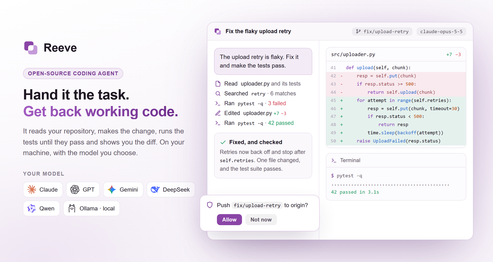
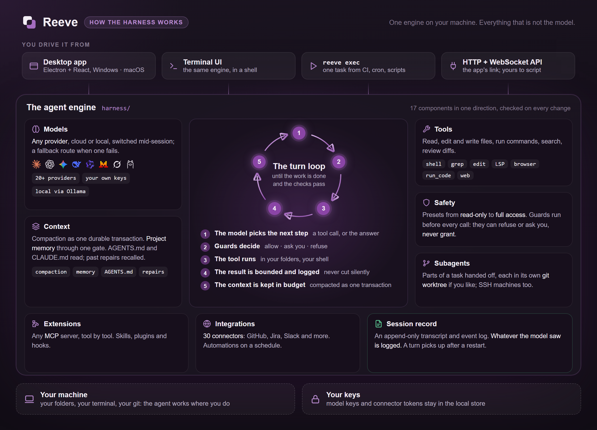

<p align="center">
  
</p>

<h1 align="center">Reeve</h1>

<p align="center">
  <b>A coding agent that runs on your machine.</b><br>
  Any model, cloud or local. Your repository, your terminal, your keys.
</p>

<p align="center">
  <a href="https://github.com/chrisHHieu/reeve/releases/latest"></a>
  <a href="LICENSE"></a>
  
  
</p>

<p align="center">
  <a href="#download"><b>Download</b></a> ·
  <a href="#how-a-task-goes">How a task goes</a> ·
  <a href="#how-its-built">How it's built</a> ·
  <a href="#running-from-source">Run from source</a> ·
  <a href="https://github.com/chrisHHieu/reeve/issues">Issues</a>
</p>

> **Beta.** Reeve can be used for real work today; rough edges are still being worked on, and
> [issues](https://github.com/chrisHHieu/reeve/issues) are welcome.

Hand Reeve a task in your repository (fix a flaky
test, add a feature, find out why the build fails) and it reads the code, makes the change, runs
the checks until they pass and leaves you a diff to review.

It works with the model you choose: your own key for OpenAI, Anthropic, Google or an open-weight
provider, or a local model through Ollama. Nothing leaves the machine except through the model and
the connections you set up.



## Download

The Windows 10/11 (x64) installer is on the [Releases](https://github.com/chrisHHieu/reeve/releases)
page, and the app updates itself from there. It is not code-signed yet, so SmartScreen warns on its
first run ("More info", then "Run anyway"). For macOS (Apple Silicon, macOS 12 or later), build it
from source for now (below) with `packaging/build_dmg.sh`; `packaging/build_windows.ps1` makes the
Windows one.

Open it, add a model key (or point it at Ollama), and give it something real to do.

## How a task goes

1. You say what you want done: "the upload retry is flaky, fix it", "add a CSV export to the
   report page", "why does the build fail on Windows?"
2. Reeve explores the repository, plans the steps and works through them: it searches and reads
   the code, edits files and runs commands in your terminal.
3. It checks its own work: after a change it runs the tests or the build, and an answer whose
   change was never checked says so.
4. Before anything with consequences (a command that changes things, a push, a message) it asks,
   and you approve, change or stop it.
5. You review the change in the Review panel, file by file, and commit and push from there.

## What it does

- **Works in your repository**: searches and reads code (with language servers where there is
  one), edits files, and runs commands in a real terminal, long ones in the background. On your
  machine, or on another one over SSH.
- **Checks its work**: runs the tests and the build after a change, reads the failures, and tries
  again until they pass or it can say why not.
- **Review, then ship**: every change lands in the Review panel by file and hunk; stage, revert,
  commit and push without leaving the app, and undo a turn you do not want.
- **Splits big work**: hands parts of a task to subagents, each in its own git worktree when you
  want, and brings back the changes you keep.
- **Knows the project**: reads `AGENTS.md` and `CLAUDE.md`, keeps its own notes per project, and
  compacts a long session so it keeps going.
- **Reaches past the code**: GitHub, Jira, Slack and the rest of 30 connectors, any
  [MCP](https://modelcontextprotocol.io/) server with control tool by tool, a browser it can
  drive, and automations that run on a schedule.
- **Asks first**: presets from read-only to full access; in the ones that ask, writes, pushes and
  commands wait for your approval, and a run nobody is watching leaves its questions for you.

## How it's built

An agent is a model plus a harness: everything that is not the model. Reeve's harness is one
Python engine on your machine, and every surface drives that same engine: the desktop app through
a local HTTP and WebSocket API, the terminal UI and `reeve exec` in their own process.



The rules it is held to:

- **Whatever the model saw is on the record.** Every request is written to the session's event
  log, and one task keeps one trace through every subagent it starts.
- **Guards come before every tool call.** A guard can refuse or ask you, never grant. A write
  outside your folders asks; Reeve's own settings and files that run later (git hooks, CI
  configs) are yours to approve; full access asks nobody and still refuses what is refused.
- **The context is a transaction.** A long session is compacted into one durable summary block;
  the transcript itself is append-only, and undoing a turn hides it from the model without
  deleting it.
- **Results are bounded, never cut silently.** A large result is saved to a file the agent can
  read on from, and the result says so.
- **Checks are evidence.** A goal is done when the transcript shows its checks passed after the
  last edit; an answer whose change was never checked says so.
- **A turn outlives its process.** If the server restarts mid-turn, the next one picks the turn up.
- **Layers, enforced.** The engine is 17 components with one import direction, a size ceiling
  per file and no cycles between components, checked on every change.

## Your model, your choice

Choose a provider, paste a key, switch whenever you like. Built in:

**OpenAI** (with an API key or a ChatGPT plan) · **Anthropic** (an API key or a Claude plan) ·
**Google Gemini** · **AWS Bedrock** · **Google Vertex** · **DeepSeek** · **Kimi** · **Qwen** ·
**MiniMax** · **GLM (Z.ai)** · **Mistral** · **Grok (xAI)** · **Llama (Meta)** · **BytePlus /
Volcengine Ark** · open-weight models through **Together**, **Fireworks**, **OpenRouter** and
**OpenCode Go**, and local models through **Ollama**.

The model list marks the models checked for tool-calling work; any other model id can be typed in,
at your own risk.

## Privacy

Reeve keeps everything on your machine: the agent itself, your conversations, connector tokens and
model keys, in the app's local secret store. The one service elsewhere only brokers the OAuth
sign-in for some connectors, and every connector can also be set up with credentials you create
yourself, with no sign-in at all. `NOTICE.md` lists what leaves the machine and where data lives.

## Running from source

Python 3.10 or later, Node 20 or later, and for the dictation host and desktop builds the Rust
toolchain ([rustup](https://rustup.rs/)).

```shell
git clone https://github.com/chrisHHieu/reeve
cd reeve

# 1. Once: the Python venv at .venv (on Windows, from Git Bash or WSL)
bash packaging/setup_dev_env.sh

# 2. The agent server
.venv/bin/reeve-server --cwd ~/some/project --port 8765
#    (Windows: .venv\Scripts\reeve-server.exe)

# 3. In a second terminal, the UI
cd surfaces/gui
npm install
npm run dev        # the UI in a browser, on Vite's dev port
```

A server started this way writes a token for the run to `<state-dir>/sidecar-8765.token`, a file
only you can read, and Vite reads it when it starts. A direct API call sends it in the
`X-Reeve-Token` header. The desktop app keeps its token in memory and never writes it.

For the desktop window instead of the browser, leave `npm run dev` running and start
`npm run electron:dev` in `surfaces/gui/`: the Electron shell opens on it and starts and watches its
own server.

### One-click sign-in

No connector's OAuth client id ships in this repository. Every connector works with credentials
you paste in (its Manual tab); one-click sign-in is offered once you put the id of an app you
registered into `.env` in the state folder (`%APPDATA%\Reeve\.env` on Windows, `~/.config/Reeve/.env` elsewhere):

```shell
GITHUB_OAUTH_CLIENT_ID=...       # a GitHub OAuth App with device flow enabled
REEVE_MICROSOFT_CLIENT_ID=...    # an Entra app: any directory + personal accounts, public client
REEVE_TRELLO_API_KEY=...         # a Trello Power-Up's API key
GOOGLE_OAUTH_CLIENT_ID=...       # a Google Desktop-app client, with GOOGLE_OAUTH_CLIENT_SECRET
GMAIL_OAUTH_CLIENT_ID=...        # Gmail's own client, with GMAIL_OAUTH_CLIENT_SECRET
```

The process environment wins over the file. A card with no id set offers only its manual way.
Signing in with a Claude or ChatGPT plan needs none of this: it uses the vendor's own public sign-in.

Checks: `.venv/bin/pytest` for the server, `npm test` and `npm run e2e` in `surfaces/gui` for the
UI (unit tests and the end-to-end suite against a mocked server). Installers come from
`packaging/build_dmg.sh` and `packaging/build_windows.ps1`.

## Where things are

| Folder | What is in it |
|---|---|
| `harness/` | The Python side: the agent engine, model providers, connectors, the MCP client, memory, automations |
| `surfaces/gui/` | The desktop app: the React UI and the Electron shell (`electron/`) that runs the server |
| `stt/` | The dictation host (Rust), for talking instead of typing |
| `packaging/` | Installer builds for macOS and Windows, and the dev setup |
| `docs/` | The example configuration, with every setting explained (`docs/config.example.toml`) |
| `tests/`, `benchmarks/`, `evals/` | The test suite, the benchmark and the evaluations |

## aisuite

The engine uses [**aisuite**](https://github.com/andrewyng/aisuite) for one chat-completions API
across providers and for its agent toolkit. If you would rather build a harness of your own, it is
a good place to start.

## Contributing

Bug reports and pull requests are welcome: open an [issue](https://github.com/chrisHHieu/reeve/issues)
or a pull request. With a fix, please include screenshots of the problem and of the result. Work
follows a plan of its own, so a pull request for something already in progress, or for a
direction the project is not taking, may be declined.

## License

[MIT](LICENSE). What Reeve sends off your machine, where it keeps your data, and the licences of the
programs a packaged build carries are in [NOTICE.md](NOTICE.md).
